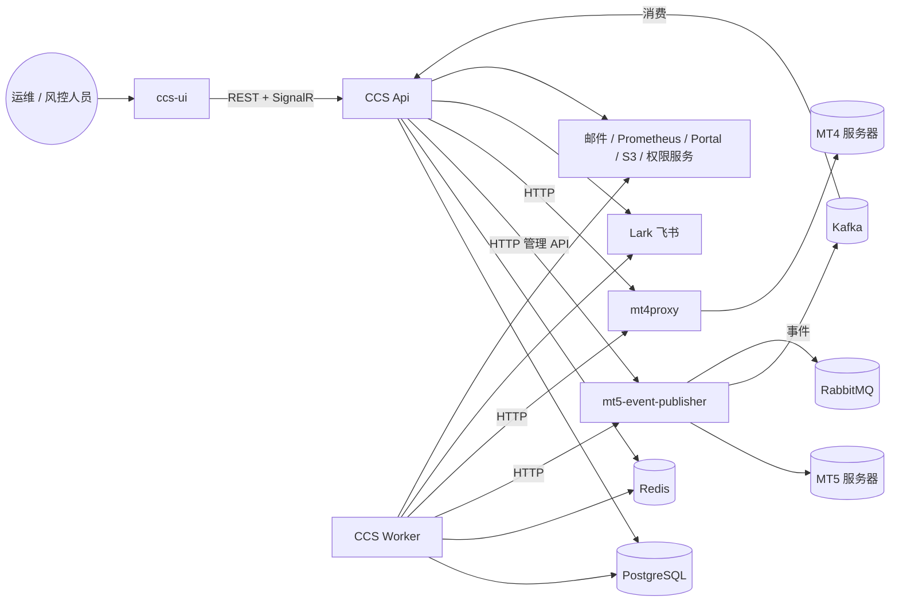

# ccs-backend 的 C4 容器图草稿（手工取证，用来钉"第一屏"）

日期：2026-10-14
目的：在重写地图设计之前，先用真实项目验证"第一屏应该是容器图"这个判断。全部内容来自静态取证（csproj、Dockerfile、Helm chart、appsettings、DI 注册、Infrastructure 目录），没有运行任何东西。标"待核实"的是推断。

## 1. 容器（可部署单元）

| 容器 | 是什么 | 证据 |
|---|---|---|
| **ccs-ui** | 浏览器前端（pnpm workspace） | `ccs-ui/ccs-src/Dockerfile`、`ccs-ui/ccs-src/ccs-app/pnpm-workspace.yaml` |
| **CCS Api** | ASP.NET Core 服务：REST 控制器（148 个）、SignalR 实时推送、Kafka 消费者、审批执行、插件同步 | `CentralizedConfigurationSystem.Api`（`Sdk.Web`，有 Dockerfile）；appsettings 节 `Realtime`、`Kafka`、`ApprovalExecutionConfig`、`PluginSyncConfig` |
| **CCS Worker** | 后台任务进程：租约 / 心跳 / 回收的作业执行器、MT4 / MT5 批量异步作业队列、审批提醒定时任务 | `CentralizedConfigurationSystem.Worker`（`Sdk.Web`，有 Dockerfile）；appsettings 节 `BackgroundWorker`、`AsyncBatchJobs`、`ApprovalReminderConfig` |
| **mt4proxy** | 独立 git 仓库：把 MT4 Manager 原生库（P23）包成 REST，一个实例连多台 MT4 服务器 | `mt4proxy/CLAUDE.md:1-28`；`MT4Proxy.Web/Controllers/{Account,Backup,DataFeed,…}Controller.cs`；环境变量 `MT4_SERVER_<NAME>` |
| **mt5-event-publisher** | 独立 git 仓库：连 MT5 服务器，把事件发到 Kafka / RabbitMQ，带 Quartz 定时任务与 Redis；对外有 HTTP 端点（批量创建组） | `mt5-event-publisher/deployments/mt5-evp/templates/*.yaml`（deployment、ingress、kafka-external-secret、mtserver-external-secret）；`Infrastructure.csproj` 引用 Confluent.Kafka、RabbitMQ.Client、StackExchange.Redis、Quartz |
| 库：**VantageFX.Redis** | 共享 Redis 封装（不是容器） | `libs/VantageFX.Redis` |

## 2. 外部系统

| 外部系统 | 谁用 | 证据 |
|---|---|---|
| PostgreSQL | Api、Worker | `Npgsql.EntityFrameworkCore.PostgreSQL`；`NpgsqlConnection` 直连 6 处（后台作业） |
| Redis | Api、Worker（经 VantageFX.Redis）、mt5-event-publisher | 包引用 |
| Kafka | Api **消费**（`KafkaEventConsumerHostedService` 订阅 `Kafka:Topics`）；mt5-event-publisher **生产** | `Infrastructure/Kafka/Consumer/KafkaEventConsumerHostedService.cs:86`；appsettings `Kafka` 节 |
| RabbitMQ | 只有 mt5-event-publisher | 包引用 |
| MT5 服务器 | 经 mt5-event-publisher：Api / Worker 的 `MT5MANAGERAPICLIENT` 指向 `MetaTraderManagerApi:Url = http://localhost:5003/api/`，mt5-event-publisher 的控制器正是 `api/account/manager/{list,get,create,batch-create,update,delete,…}` 这套路由，与命令注释"via the mt5-event-publisher bulk-create endpoint"一致 | `Bootstrap/DependencyInjectionSetup.cs`（AddHttpClient）；`Publisher/Controllers/Accounts/ManagerController.cs`；`Infrastructure/MT5/Utilities/Mt5EndpointResolver.cs`（按 ServerId 选 URL）。基本确认；端口对应关系在部署配置里 |
| MT4 服务器 | 经 mt4proxy：`MT4MANAGERAPICLIENT` → `MetaTraderManagerMT4Api:Url = http://localhost:5162/`，正是 `mt4proxy/CLAUDE.md` 写的 MT4Proxy.Web 端口；另有 6 处 gRPC `GrpcChannel`（`Mt4X86ServiceClientFactory`，MT4 x86 数据源服务） | `Bootstrap/DependencyInjectionSetup.cs`；`Infrastructure/MT4/Services/MT4Group/MT4GroupService.cs`（注入 `IOptions<MetaTraderManagerMT4Api>`）；`Infrastructure/MT4/DataFeeds/Services/Mt4X86ServiceClientFactory.cs`。HTTP 边已确认；gRPC 对端**待核实** |
| Lark（飞书） | Api、Worker：审批卡片、提醒、通知（`LARKAPICLIENT`，`Infrastructure/Lark/`，960 处引用） | appsettings `LarkBotConfig`；`Infrastructure/Lark/Services/LarkApprovalService.cs` |
| 邮件 API、Prometheus、Portal、AWS S3、角色权限服务 | Api、Worker | appsettings `EmailConfig.ApiUrl`、`PrometheusConfig`、`PortalConfig`、`AwsS3Config`、`RolePermissionConfig`；`AddHttpClient("Prometheus")` |
| OpenTelemetry 收集器 | 全部 .NET 容器 | `OpenTelemetry.Exporter.OpenTelemetryProtocol` |

## 3. 容器图

读法：左边是人和前端，中间两个 .NET 进程分担"同步请求"与"后台作业"，右边两个代理把 MT4 / MT5 的私有协议包成 HTTP，事件再经 Kafka 回流到 Api。**这一屏回答的是"这个系统由哪几个进程组成、各自碰什么外部系统"**，与命名空间无关，换任何多项目仓库都成立。

## 4. 往下一层：Api 内部的组件依赖（DSM 预览）

项目引用关系（证据：各 csproj 的 `ProjectReference`）：

| 行依赖列 → | Shared | Domain | Application | Infrastructure | Bootstrap |
|---|---|---|---|---|---|
| Domain | ● | | | | |
| Application | ● | ● | | | |
| Infrastructure | | ● | ● | | |
| Bootstrap | | | | ● | |
| Api | | | | ● | ● |
| Worker | | | | | ● |
| Tests | | | | ● | （引用 Api） |

- 下三角、没有环：分层干净。
- 一处值得标出来的：**Api 直接引用 Infrastructure**，而 Worker 只引用 Bootstrap。如果约定是"宿主只经 Bootstrap 装配"，Api 这条是层次违规；ccs-backend 自己的 `PipelineArchitectureTests`（NetArchTest）是现成的"声明的规则"来源，地图应该读它，而不是自己猜分层。

组件级（命名空间）的 DSM 由工具生成，这里不手工画。

## 5. 再往下一层：一条入口的流程（示例，待用调用链核实）

`ccs-ui → Api.Mt5GroupController.BatchCreate → Dispatcher → Validation → Permission → Approval → Audit → BatchCreateMt5GroupsHandler → MT5 管理 API（HTTP）→ mt5-event-publisher → MT5 服务器`；MT5 侧产生的事件 `→ Kafka → Api.KafkaEventConsumerHostedService → IEventHandler`。

证据：`BatchCreateMt5GroupsCommand` 的文档注释写明"via the mt5-event-publisher bulk-create endpoint"；命令实现 `IRequiresPermission` 与 `IAuditable`，**没有实现 `IApprovable`**——这正是"流程图上该标出来的缺口"的例子（是否有意为之，由业务方判断，工具只负责指出）。

## 6. 这张草稿要回答的问题

1. 第一屏是不是这个？如果是，CodeAtlas 的顶层就按 C4 容器图做，容器与外部系统从 csproj / Dockerfile / Helm / appsettings / `AddHttpClient` / 消息客户端注册里静态发现，仓库可用一份 C4 风格的声明文件覆盖或补充。
2. "待核实"的两处（MT5 管理 API 的指向、gRPC 对端）由谁确认？这类跨进程的边静态只能到"配置键名"，真正的目标地址在部署环境里。
